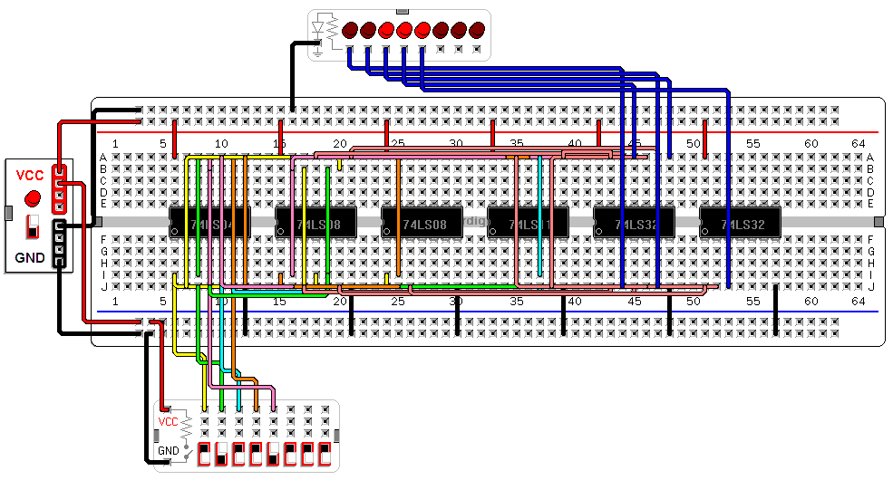

# Decodificador 2 entre 5 → Johnson

Simulador interativo de um decodificador combinacional que converte o **código 2 entre 5** no **código Johnson**, com o circuito montado e testado no *Constructor Virtual de Circuitos*.

**▶ Abrir o simulador:** https://anarochacs06-dev.github.io/Projeto-Eletr-nica-/

| | |
|---|---|
| **Instituição** | IFMT Campus Cuiabá – Cel. Octayde Jorge da Silva |
| **Curso / disciplina** | Engenharia da Computação · Eletrônica Digital |
| **Alunos** | Ana Clara Rocha e Pedro Luiz |
| **Professor** | Edelson Duarte |
| **Ano** | 2026 |



## O circuito

O circuito tem 5 entradas (A B C D E) em código 2 entre 5, em que sempre há exatamente dois bits em 1, e 5 saídas (S4 S3 S2 S1 S0) em código Johnson.

| Decimal | A B C D E | S4 S3 S2 S1 S0 |
|:-:|:-:|:-:|
| 0 | 0 0 0 1 1 | 0 0 0 0 0 |
| 1 | 0 0 1 0 1 | 0 0 0 0 1 |
| 2 | 0 0 1 1 0 | 0 0 0 1 1 |
| 3 | 0 1 0 0 1 | 0 0 1 1 1 |
| 4 | 0 1 0 1 0 | 0 1 1 1 1 |
| 5 | 0 1 1 0 0 | 1 1 1 1 1 |
| 6 | 1 0 0 0 1 | 1 1 1 1 0 |
| 7 | 1 0 0 1 0 | 1 1 1 0 0 |
| 8 | 1 0 1 0 0 | 1 1 0 0 0 |
| 9 | 1 1 0 0 0 | 1 0 0 0 0 |

Das 32 combinações de 5 bits, só 10 são válidas. As outras 22 foram tratadas como indiferentes (X) na simplificação por mapa de Karnaugh:

```
S4 = A + D'E'
S3 = AB' + A'BE'
S2 = A'B + AB'C'
S1 = A'E' + EC'D'
S0 = A'D' + A'E'
```

As cinco expressões foram conferidas com as 10 entradas válidas.

## O simulador

A página [`index.html`](index.html) é um arquivo único, sem dependências de instalação. Ela tem:

- **Bancada:** chaves A–E, o dígito decodificado, um aviso para entrada fora do código e LEDs S4–S0. Teclado: `A`–`E` alternam as chaves e `0`–`9` carregam um dígito.
- **Esquema de portas ao vivo:** os fios mudam de cor conforme o nível lógico.
- **Expressões e tabela-verdade:** os termos ativos ficam destacados, e clicar numa linha da tabela carrega o dígito.
- **Montagem passo a passo:** a protoboard do Constructor desenhada a partir do arquivo do circuito, em 9 passos (placas, alimentação, CIs, VCC/GND, entradas, complementos, produtos, saídas e teste). No modo teste dá para clicar nas chaves da própria placa.

## Montagem no Constructor Virtual de Circuitos

| CI | Função | Colunas na protoboard |
|---|---|---|
| U1 · 74LS04 | inversores: A′ B′ C′ D′ E′ | 6–12 |
| U2 · 74LS08 | AND: D′E′, AB′, A′B, A′E′ | 15–21 |
| U3 · 74LS08 | AND: A′D′ | 24–30 |
| U4 · 74LS11 | AND de 3 entradas: A′BE′, AB′C′, EC′D′ | 33–39 |
| U5 · 74LS32 | OR: S4, S3, S2, S1 | 42–48 |
| U6 · 74LS32 | OR: S0 | 51–57 |

Para abrir:

1. No Constructor (versão 0.9.7a), vá em **Circuitos → Abrir** e escolha [`circuito-constructor/decodificador-2de5-johnson.txt`](circuito-constructor/decodificador-2de5-johnson.txt).
2. Ligue a chave da fonte DC.
3. As chaves 1–5 da placa de interruptores são A–E. Uma chave vale 1 quando o bloco preto está embaixo.
4. Os LEDs 1–5 são S4–S0.

O circuito foi testado no próprio Constructor com os 10 dígitos, e os 10 acenderam os LEDs esperados.

O Constructor Virtual é um programa de terceiros (Arturo J. Miguel de Priego Paz Soldán, [tourdigital.net](http://www.tourdigital.net)) e não faz parte deste repositório.

## Estrutura

```
index.html                       página publicada no GitHub Pages (gerada)
simulador-decodificador.html     código-fonte do simulador
gerar-pages.ps1                  gera index.html a partir do simulador
circuito-constructor/
  decodificador-2de5-johnson.txt circuito para o Constructor (formato 0.9.7)
  gerar-circuito.ps1             gera o arquivo do circuito
  montagem-constructor.png       captura do Constructor (dígito 3)
decodificador de código 2 entre 5 para código Johnson.pdf   relatório
```

Depois de editar `simulador-decodificador.html`, gere a página publicada de novo:

```powershell
powershell -ExecutionPolicy Bypass -File gerar-pages.ps1
```

Para regenerar o circuito do Constructor:

```powershell
powershell -ExecutionPolicy Bypass -File circuito-constructor\gerar-circuito.ps1
```

## Observação sobre o relatório

O diagrama de portas da página 9 do relatório não bate com as expressões em três pontos:

- **S3:** o 2º AND recebe A no lugar de A′.
- **S1:** o 1º AND recebe A no lugar de A′, e o 2º AND recebe D no lugar de D′.
- **S2:** no 2º AND, o inversor está desenhado na linha de A, mas rotulado B′.

O simulador e a montagem seguem as expressões, que estão corretas.
